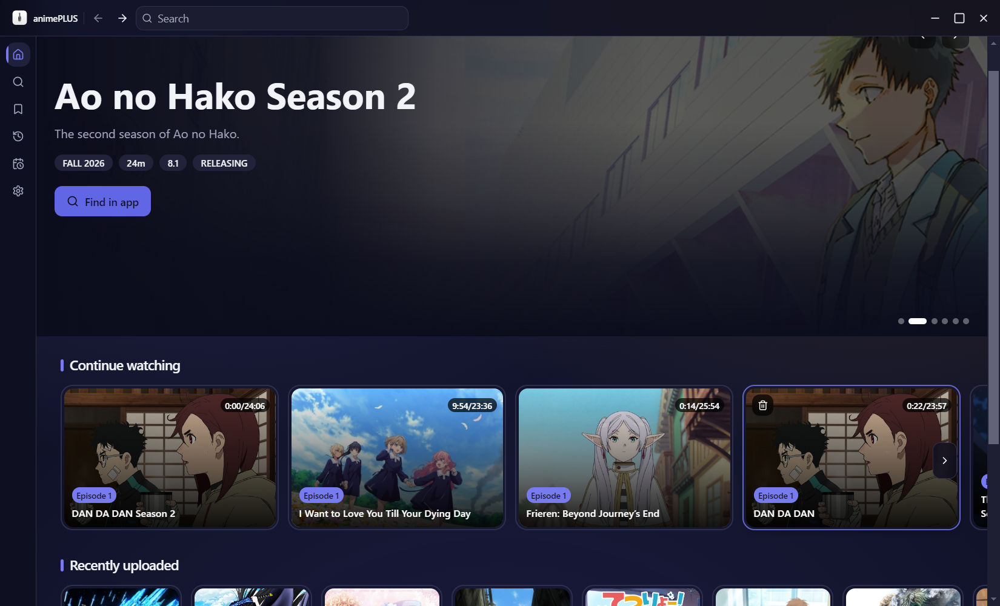
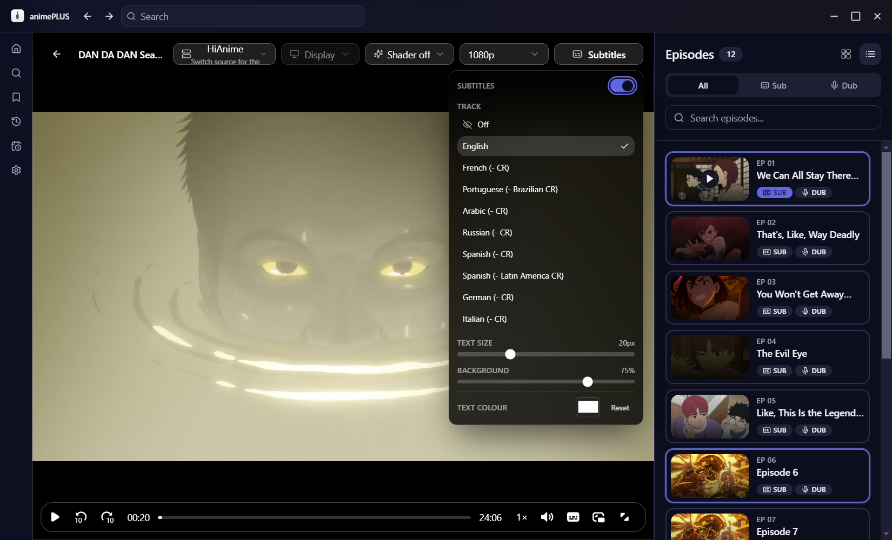
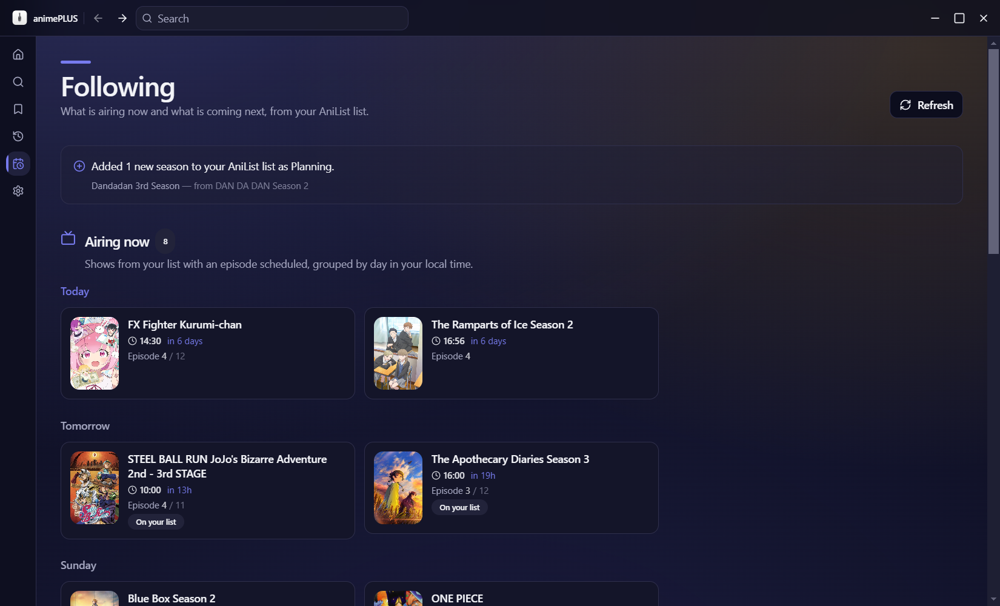
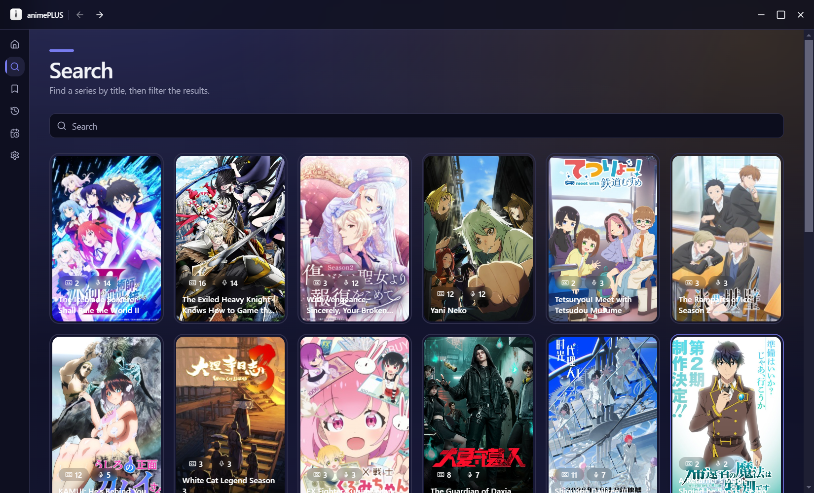
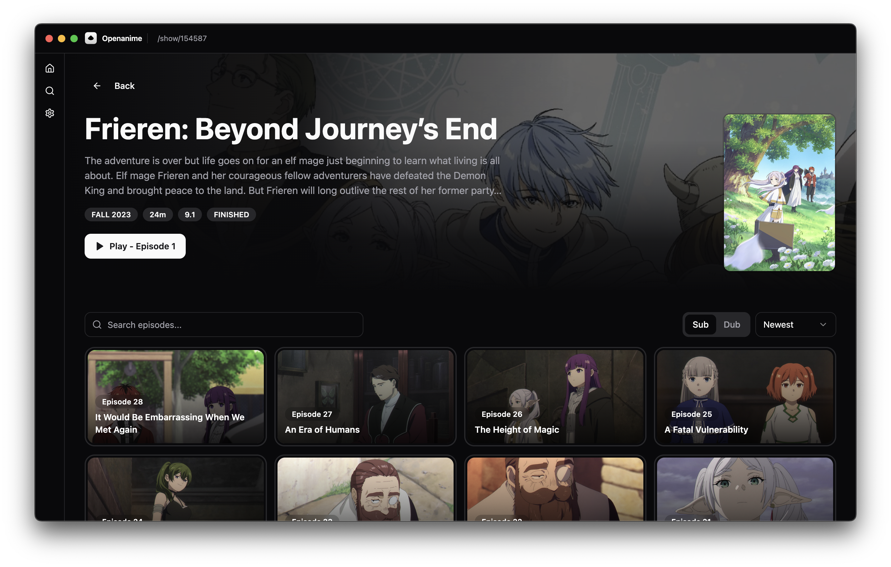
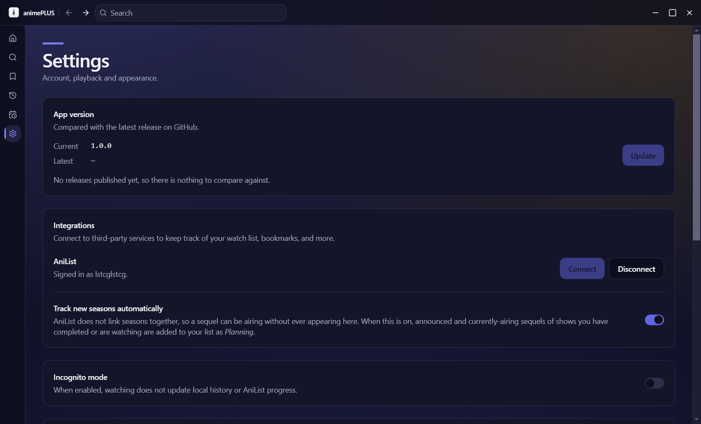

# animePLUS

[Features](#features) | [Stream sources](#stream-sources) | [Installation](#installation) | [Building](#building) | [License](#license)



**animePLUS** is an easy-to-use desktop anime application with a provider-based architecture. The current provider implementation builds on ideas from [pystardust/ani-cli](https://github.com/pystardust/ani-cli), while keeping the app ready for additional providers over time.

Built and maintained by **Luiss896**.

## Features

- Stay up to date with the most recently uploaded anime
- Browse and search for a specific anime series
- Sub / dub support
- **Multiple stream sources with live host switching** — change provider mid-episode without losing your position, for when one source lacks the episode or its subtitles
- **Subtitle controls** — pick a track (including Italian where the source carries it), turn subtitles off, and adjust text size, background opacity and colour. Preferences persist between sessions
- **AniList integration** — your list drives the *Following* page (what airs today and what comes next) and the *Continue watching* row, with one-click removal per show
- **Anime4K upscaling over WebGPU** with selectable presets (A, B, C, A+A, GAN)
- **Native-resolution output**: the shader renders straight to your monitor's pixel grid (e.g. 1080p → 1440p at 1:1), instead of letting the compositor rescale the result
- Adjustable output resolution: source, display, 1080p, 1440p or 4K
- Quality warning when a stream has no 1080p rendition available

## Stream sources

Sources are toggled in `desktop/src/shared/stream-providers.config.ts`; each one is compiled
and instantiated regardless, so enabling or disabling is a one-line change.

| Source | Status | Notes |
|---|---|---|
| **HiAnime** | Enabled | Primary. Reports a full quality ladder, so the quality selector and the 1080p warning are meaningful. The only enabled source that carries selectable subtitles, including Italian on some titles. |
| **AnimeUnity** | Enabled | Italian fallback. Japanese audio with **Italian subtitles burned into the video**, so they cannot be toggled — the subtitle panel says so rather than showing dead controls. |
| Reanime | Disabled | Subtitles work (many `.ass` tracks per show, converted to WebVTT on the fly), but it **cannot play video**: every playlist its CDN serves contains image segments (WebP/PNG), not video. See below. |
| AllAnime | Disabled | Upstream broke: the `episode` query now requires `translationType`, and its request-signing crypto must be scraped from an obfuscated bundle. |
| AnimeParadise | Disabled | Works, but carries no subtitle tracks at all. |
| AniDB, AnimePahe, Senshi | Disabled | Search currently fails or returns nothing. |

> **On Reanime:** its master playlist advertises `CODECS="avc1.64001f,mp4a.40.2"` but every
> segment it serves is an image — measured across four shows by reading the segment magic bytes
> (`RIFF....WEBP`, `image/png`). Nothing in the app can play that, so the source is off.

> **On Italian subtitles:** no free source carries them for every title. Coverage was measured
> across 15 popular shows — HiAnime had a working Italian track on 4, Reanime on 2 (but see
> above). If a show has no Italian track, switch host from the player and check again.

## Installation

### Windows

Download the latest `animePLUS-*.Setup.exe` from the [releases page](../../releases) and run it.

The build is not code-signed, so SmartScreen may warn you on first launch. Choose *More info → Run anyway*, or verify the source yourself — the full source is in this repository.

### macOS

Download the latest `animePLUS-darwin-arm64-*.zip` from the [releases page](../../releases) and unzip
it (Apple Silicon).

Because the application is not signed or notarized, macOS will attach a `com.apple.quarantine` flag
and Gatekeeper may refuse to launch it. Clearing that flag is the workaround:

```bash
xattr -cr /Applications/animePLUS.app
```

Downloading an app from outside the App Store attaches `com.apple.quarantine` to it; if the app is
not correctly signed, Gatekeeper blocks it. Running `xattr -cr` on the application folder wipes
those flags, so macOS treats the file as locally created and allows it to run.

### Linux

Not supported, and no Linux packages are produced. If you want to run it there anyway, build from
source (see [Building](#building)) — the Linux makers have been removed from the Forge config, so
`npm run make` will only produce the Windows and macOS artifacts.

## Building

Requires Node.js 20+.

```bash
# from the desktop/ directory
npm install
npm start          # development, with dev server and hot reload
```

To produce a distributable build:

```bash
npm run make       # installers for the current platform
# or
npm run package    # unpacked app in out/
```

FFmpeg is downloaded automatically on install and before packaging; the binary is not committed to the repository.

> **Note for AniList login:** the OAuth redirect uses a custom deep-link scheme (`animeplus://auth/anilist/callback`). If you fork this project, you must register your own client ID and matching redirect URI in the AniList API settings, otherwise the "Connect AniList" flow will fail at the callback step.

## Additional Screenshots

### Player and subtitle controls

Pick a track — Italian included when the source carries it — then adjust text size, background
opacity and colour. The appearance settings are remembered between sessions.



### Following

What airs today and what is coming next, straight from your AniList list. Every card opens the
show in the app, not in a browser.



### Search



### Show details



### Settings



## Legal

animePLUS is a client application. It does **not** host, store, or distribute any video content. All media is fetched from third-party services chosen by the user.

## License

[AGPL-3.0-or-later](./LICENSE) — Copyright (C) 2025 Luiss896.

This program is free software: you can redistribute it and/or modify it under the terms of the GNU Affero General Public License as published by the Free Software Foundation, either version 3 of the License, or (at your option) any later version.

**In short:** you may read, run and modify this code, but any redistributed or network-hosted version must remain open source under the same license and must keep the attribution intact. Taking this code, closing it, and shipping it as your own proprietary product is not permitted. See [NOTICE](./NOTICE) for the additional terms under section 7 of the AGPL.
